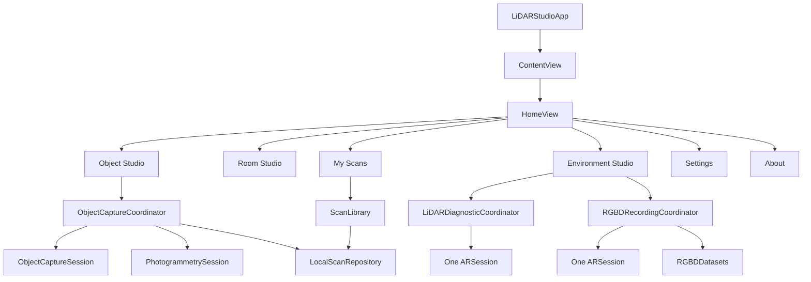
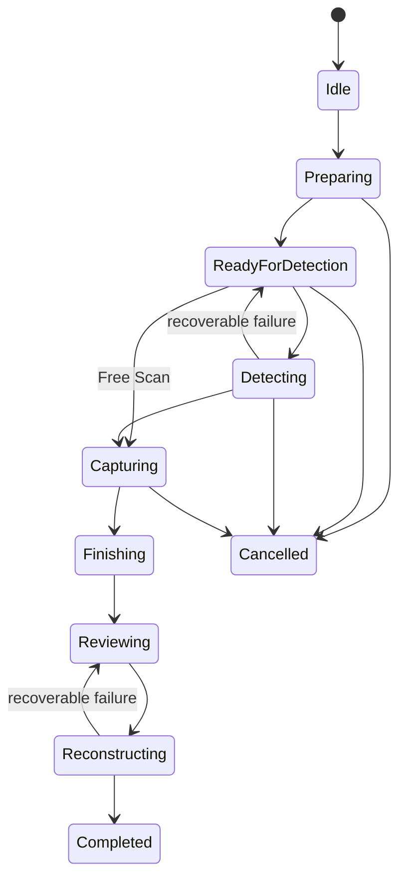

# LiDARStudio application architecture

Copyright © 2026 Dugi Selmanaj. All rights reserved.

Status: current implementation snapshot, 2026-11-04.

This document describes the code that exists today. It is distinct from the
research proposals in `docs/research/rvp/` and does not claim that unfinished
hardware workflows are production-ready.

## System context

LiDARStudio is a native SwiftUI iPhone application. It uses public Apple APIs,
keeps scan artifacts local by default, and separates camera-owning workflows so
that only one capture engine is active at a time.



## Application composition

- `LiDARStudioApp` owns one `ScanLibrary` and injects it through the SwiftUI
  environment.
- `ContentView` owns the root `NavigationStack` and forwards background scene
  transitions to `ScreenAwakeManager`.
- `AppNavigationState` owns typed top-level destinations. First-launch
  onboarding is presentation state only and never starts a camera session.
- Each studio is a feature boundary. Object Studio and Environment Studio own
  separate coordinators; Room Studio currently exposes only foundation UI and
  capability status.
- `StudioTheme` and shared scanner components provide the premium dark design
  system without owning hardware resources.

## Camera and session ownership

Camera ownership is a hard invariant:

1. `ObjectCaptureCoordinator` owns at most one `ObjectCaptureSession`.
2. `LiDARDiagnosticCoordinator` owns at most one diagnostic `ARSession`.
3. `RGBDRecordingCoordinator` owns at most one recording `ARSession`.
4. Environment Studio disables conflicting start actions while either its
   diagnostic or recorder is active.
5. Navigation dismissal, cancellation, failure, completion, and backgrounding
   release the relevant session through idempotent cleanup.
6. No `AVCaptureSession` is run alongside Object Capture or ARKit.

There is not yet a process-wide `CaptureArbiter`. The current guarantee relies
on feature isolation, navigation, coordinator guards, and cleanup. A global
arbiter remains a future hardening option if multiple camera features can ever
be presented simultaneously.

## Object Studio lifecycle



`ObjectStudioTransitionPolicy` validates application transitions.
`ObjectDetectionLifecycle` serializes detection, rejects double taps, and
prevents stale callbacks from reviving a cancelled session. Framework callbacks
are accepted only from the currently observed session.

Capture originals are preserved in a draft workspace. Reconstruction uses a
separate `PhotogrammetrySession`, writes a candidate USDZ, validates the output,
then creates library metadata. A false detection result is recoverable and is
not treated as a completed scan.

## Environment diagnostics and RGB-D recording

The diagnostic stages are deliberately isolated:

- Basic: `ARWorldTrackingConfiguration` only.
- Depth: Basic plus `.sceneDepth` frame semantics.
- Mesh: Depth plus `.mesh` scene reconstruction.

The diagnostic session has no RealityKit/Metal preview. Delegate callbacks run
on a dedicated serial queue, metrics are locked off the main thread, and SwiftUI
publication is throttled.

The RGB-D recorder uses one `ARSession` and a bounded writer:

- maximum 180 accepted samples;
- sampling interval of 0.5 seconds;
- maximum two pending writes;
- no retained `ARFrame` objects;
- a frame is accepted only when real ARKit depth is present;
- RGB, depth, confidence, intrinsics, transform, timestamp, and tracking state
  are persisted together.

An empty or structurally invalid recording remains visible as failed evidence;
it is never promoted to a successful dataset.

## Storage architecture

Object scans use the app Documents container:

```text
Documents/LiDARStudio/
├── scans.json
├── Models/
│   └── <UUID>.usdz
├── Previews/
│   └── <filename>
└── Captures/
    └── <UUID>/
        ├── capture.json
        ├── Images/
        ├── CaptureCheckpoints/
        └── ReconstructionCheckpoints/
```

RGB-D experiments use a separate Application Support location:

```text
Application Support/RGBDDatasets/<UUID>/
├── manifest.json
└── frames/
```

`LocalScanRepository` rejects escaping model, preview, and capture paths. Model
opening rejects symbolic links, empty files, non-USDZ extensions, and files
without the ZIP/USDZ container signature. Metadata writes are atomic and
versioned through `ScanMetadata.schemaVersion`.

Library deletion is available only after explicit destructive confirmation. It
validates every referenced local path, persists the remaining metadata, then
removes the selected model, preview, and capture directory. Rename, favorites,
search, and sorting operate on real persisted metadata.

Quick Look provides Apple's native USDZ interaction. `ModelFileInfo` validates
the local model before presentation, and sharing is an explicit system Share
Sheet action.

## Screen-awake lifecycle

`ScreenAwakeManager` centrally controls `UIApplication.isIdleTimerDisabled`.
It uses independent session tokens so one active scanner cannot accidentally
restore auto-lock while another authorized operation still needs the screen.
Every terminal reason and app backgrounding restores normal idle behavior.

## Concurrency and observability

- UI-facing coordinators are `@MainActor`.
- ARKit delegates and file writers use dedicated queues.
- State updates are throttled before reaching SwiftUI.
- Cleanup is idempotent and cancels observation/reconstruction tasks.
- `OSLog` records lifecycle events without camera images or depth payloads.
- Hardware counters represent actual callbacks or files, never simulated
  progress or fabricated coverage.

## Trust boundaries

- Apple frameworks own camera capture, tracking, Object Capture, RoomPlan, and
  photogrammetry internals.
- LiDARStudio validates public framework outputs before persistence or success
  presentation.
- Share actions pass explicit local URLs to the system share sheet. Destination
  selection and any resulting transfer are controlled by the user and iOS.
- Git must never contain local scans, datasets, developer certificates, or
  provisioning profiles.

## Extension rules

New scanner engines must:

1. use public documented APIs;
2. have one explicit session owner;
3. integrate cancellation, backgrounding, and screen-awake cleanup;
4. store data in a feature-specific local directory;
5. add non-hardware state and persistence tests;
6. distinguish implementation from physical-device verification;
7. record an architecture decision before changing a core invariant.
